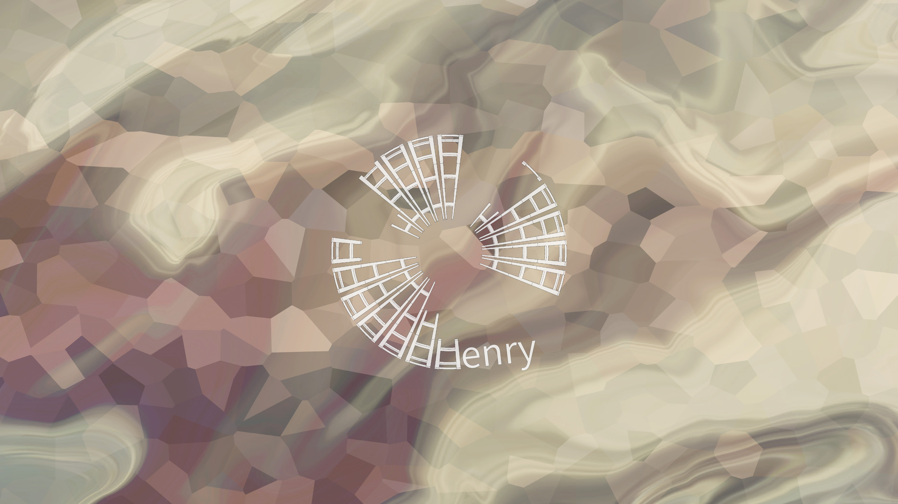

# Hello, I'm Henry :coffee:

> #### Spend a little more time trying to make something of yourself and a little less time trying to impress people.
 


---


### Spotify Playing 🎧

[](https://open.spotify.com/user/31uznrpamxhroyd2bt7xchxgnhce)

---

[](https://github.com/Pranesh-2005/github-readme-stats-fast)

<!--START_SECTION:waka-->


**🐱 My GitHub Data** 

> 📦 478.9 kB Used in GitHub's Storage 
 > 
> 🏆 1,608 Contributions in the Year 2026
 > 
> 🚫 Not Opted to Hire
 > 
> 📜 24 Public Repositories 
 > 
> 🔑 10 Private Repositories 
 > 
📊 **This Week I Spent My Time On** 

```text
🕑︎ Time Zone: Asia/Taipei

💬 Programming Languages: 
Markdown                 27 hrs 8 mins       ██████████░░░░░░░░░░░░░░░   38.06 % 
Other                    12 hrs 58 mins      █████░░░░░░░░░░░░░░░░░░░░   18.19 % 
JavaScript               7 hrs 28 mins       ███░░░░░░░░░░░░░░░░░░░░░░   10.49 % 
Bash                     5 hrs 51 mins       ██░░░░░░░░░░░░░░░░░░░░░░░   08.21 % 
Python                   3 hrs 58 mins       █░░░░░░░░░░░░░░░░░░░░░░░░   05.56 % 

🔥 Editors: 
Claude Code              67 hrs 39 mins      ████████████████████████░   94.89 % 
Codex Vscode             3 hrs 8 mins        █░░░░░░░░░░░░░░░░░░░░░░░░   04.40 % 
VS Code                  19 mins             ░░░░░░░░░░░░░░░░░░░░░░░░░   00.45 % 
Opencode Cli             8 mins              ░░░░░░░░░░░░░░░░░░░░░░░░░   00.19 % 
Codex CLI                2 mins              ░░░░░░░░░░░░░░░░░░░░░░░░░   00.07 % 

🐱‍💻 Projects: 
teamsync-frontend        34 hrs 49 mins      ████████████░░░░░░░░░░░░░   48.84 % 
chezmoi                  22 hrs 29 mins      ████████░░░░░░░░░░░░░░░░░   31.54 % 
RPA-Block                5 hrs 24 mins       ██░░░░░░░░░░░░░░░░░░░░░░░   07.58 % 
skillshare               3 hrs 23 mins       █░░░░░░░░░░░░░░░░░░░░░░░░   04.76 % 
vivispa-frontend         1 hr 58 mins        █░░░░░░░░░░░░░░░░░░░░░░░░   02.78 % 

💻 Operating System: 
Linux                    71 hrs              █████████████████████████   99.59 % 
Windows                  17 mins             ░░░░░░░░░░░░░░░░░░░░░░░░░   00.41 % 
```

🤖 **AI Coding This Week** 

```text
⏱ AI Coding Time: 71 hrs (99.59%)

✍️ 54,115 lines written by AI, 0 lines written by hand (100.0% AI-written)

🔤 50,774,571 Input Tokens, 10,216,722 Output Tokens

💵 $962.70 Estimated AI Cost This Week

🧠 153 AI Sessions, 1805 AI Prompts

Opus                     57,354 lines        █████████████████████████   99.85 % 
GPT                      86 lines            ░░░░░░░░░░░░░░░░░░░░░░░░░   00.15 % 
Haiku                    0 lines             ░░░░░░░░░░░░░░░░░░░░░░░░░   00.00 % 

🔎 AI Coding Insights:
🤖 AI-Driven — 100.0% of written lines came from AI
📚 Verbose Prompter — average 1,860 characters per prompt
🔁 Iterative Prompter — average 12 prompts per session
🚀 High AI Trust — 0.0% of changed lines were hand-edited
```


 Last Updated on 2026-11-08 21:39:41 UTC
<!--END_SECTION:waka-->

---

### Link ↗️

- #### [Project](https://drive.google.com/drive/folders/1APQlkPhpVlf63qN5CJRx-D9h8z-6oT8D?usp=sharing)
- #### [HackMD](https://hackmd.io/@henry5720)
- #### [Sketchfab](https://sketchfab.com/henry4294967296/models)
- #### [dotfile](https://github.com/henry5720/dotfiles)

https://github.com/user-attachments/assets/337b5025-1d23-4c9a-86c6-cfba083f6888

### Counter
](https://count.getloli.com/@henry5720?name=henry5720&theme=random&padding=7&offset=0&align=top&scale=1&pixelated=1&darkmode=1)
