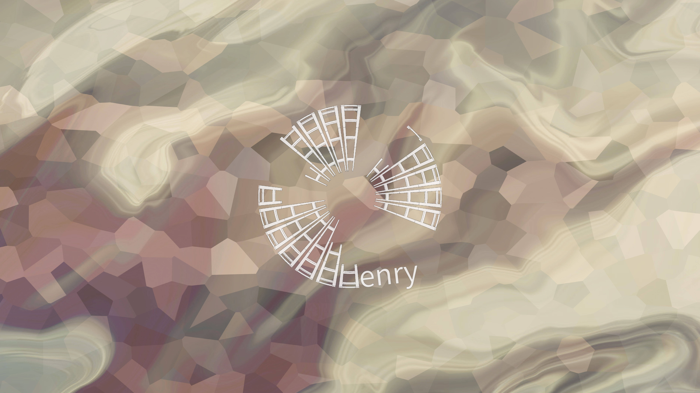

# Hello, I'm Henry :coffee:

> #### Spend a little more time trying to make something of yourself and a little less time trying to impress people.
 


---


### Spotify Playing 🎧

[](https://open.spotify.com/user/31uznrpamxhroyd2bt7xchxgnhce)

---

[](https://github.com/Pranesh-2005/github-readme-stats-fast)

<!--START_SECTION:waka-->


**🐱 My GitHub Data** 

> 📦 498.9 kB Used in GitHub's Storage 
 > 
> 🏆 2,194 Contributions in the Year 2026
 > 
> 🚫 Not Opted to Hire
 > 
> 📜 24 Public Repositories 
 > 
> 🔑 12 Private Repositories 
 > 
📊 **This Week I Spent My Time On** 

```text
🕑︎ Time Zone: Asia/Taipei

💬 Programming Languages: 
Other                    15 hrs 19 mins      ████████░░░░░░░░░░░░░░░░░   32.48 % 
Markdown                 13 hrs 41 mins      ███████░░░░░░░░░░░░░░░░░░   29.02 % 
JavaScript               5 hrs 13 mins       ███░░░░░░░░░░░░░░░░░░░░░░   11.07 % 
TypeScript               2 hrs 29 mins       █░░░░░░░░░░░░░░░░░░░░░░░░   05.28 % 
Python                   2 hrs 12 mins       █░░░░░░░░░░░░░░░░░░░░░░░░   04.69 % 

🔥 Editors: 
Claude Code              46 hrs 11 mins      ████████████████████████░   97.88 % 
Codex Vscode             42 mins             ░░░░░░░░░░░░░░░░░░░░░░░░░   01.49 % 
VS Code                  15 mins             ░░░░░░░░░░░░░░░░░░░░░░░░░   00.54 % 
Codex CLI                2 mins              ░░░░░░░░░░░░░░░░░░░░░░░░░   00.10 % 
Codex Exec               0 secs              ░░░░░░░░░░░░░░░░░░░░░░░░░   00.00 % 

🐱‍💻 Projects: 
code                     18 hrs 2 mins       ██████████░░░░░░░░░░░░░░░   38.23 % 
teamsync-frontend        13 hrs 38 mins      ███████░░░░░░░░░░░░░░░░░░   28.90 % 
chezmoi                  6 hrs 38 mins       ████░░░░░░░░░░░░░░░░░░░░░   14.09 % 
RPA-Block                3 hrs 43 mins       ██░░░░░░░░░░░░░░░░░░░░░░░   07.88 % 
skillshare               2 hrs 39 mins       █░░░░░░░░░░░░░░░░░░░░░░░░   05.64 % 

💻 Operating System: 
Linux                    46 hrs 29 mins      █████████████████████████   98.51 % 
WSL                      28 mins             ░░░░░░░░░░░░░░░░░░░░░░░░░   01.02 % 
Windows                  13 mins             ░░░░░░░░░░░░░░░░░░░░░░░░░   00.47 % 
```

🤖 **AI Coding This Week** 

```text
⏱ AI Coding Time: 46 hrs 57 mins (99.49%)

✍️ 16,703 lines written by AI, 21 lines written by hand (99.87% AI-written)

🔤 44,071,180 Input Tokens, 6,507,649 Output Tokens

💵 $671.99 Estimated AI Cost This Week

🧠 106 AI Sessions, 1290 AI Prompts

Opus                     18,396 lines        █████████████████████████   99.77 % 
Sonnet                   43 lines            ░░░░░░░░░░░░░░░░░░░░░░░░░   00.23 % 
GPT                      0 lines             ░░░░░░░░░░░░░░░░░░░░░░░░░   00.00 % 
Haiku                    0 lines             ░░░░░░░░░░░░░░░░░░░░░░░░░   00.00 % 

🔎 AI Coding Insights:
🤖 AI-Driven — 99.87% of written lines came from AI
📚 Verbose Prompter — average 2,045 characters per prompt
🔁 Iterative Prompter — average 12 prompts per session
🚀 High AI Trust — 0.23% of changed lines were hand-edited
```


 Last Updated on 2026-11-28 01:03:27 UTC
<!--END_SECTION:waka-->

---

### Link ↗️

- #### [Project](https://drive.google.com/drive/folders/1APQlkPhpVlf63qN5CJRx-D9h8z-6oT8D?usp=sharing)
- #### [HackMD](https://hackmd.io/@henry5720)
- #### [Sketchfab](https://sketchfab.com/henry4294967296/models)
- #### [dotfile](https://github.com/henry5720/dotfiles)

https://github.com/user-attachments/assets/337b5025-1d23-4c9a-86c6-cfba083f6888

### Counter
](https://count.getloli.com/@henry5720?name=henry5720&theme=random&padding=7&offset=0&align=top&scale=1&pixelated=1&darkmode=1)
