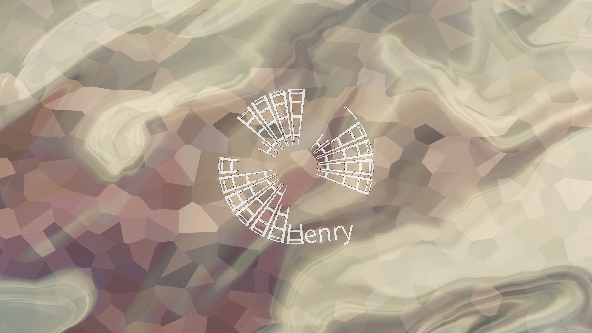

# Hello, I'm Henry :coffee:

> #### Spend a little more time trying to make something of yourself and a little less time trying to impress people.
 


---


### Spotify Playing 🎧

[](https://open.spotify.com/user/31uznrpamxhroyd2bt7xchxgnhce)

---


[](https://github.com/Pranesh-2005/github-readme-stats-fast)

<!--START_SECTION:waka-->


**🐱 My GitHub Data** 

> 📦 471.3 kB Used in GitHub's Storage 
 > 
> 🏆 1,034 Contributions in the Year 2026
 > 
> 🚫 Not Opted to Hire
 > 
> 📜 25 Public Repositories 
 > 
> 🔑 10 Private Repositories 
 > 
📊 **This Week I Spent My Time On** 

```text
🕑︎ Time Zone: Asia/Taipei

💬 Programming Languages: 
Other                    28 hrs 32 mins      ████████████████████████░   96.72 % 
Markdown                 43 mins             █░░░░░░░░░░░░░░░░░░░░░░░░   02.45 % 
JavaScript               8 mins              ░░░░░░░░░░░░░░░░░░░░░░░░░   00.47 % 
Python                   2 mins              ░░░░░░░░░░░░░░░░░░░░░░░░░   00.16 % 
JSON                     2 mins              ░░░░░░░░░░░░░░░░░░░░░░░░░   00.13 % 

🔥 Editors: 
OpenCode                 29 hrs 4 mins       █████████████████████████   98.51 % 
Claude Code              13 mins             ░░░░░░░░░░░░░░░░░░░░░░░░░   00.78 % 
Opencode Cli             7 mins              ░░░░░░░░░░░░░░░░░░░░░░░░░   00.40 % 
Codex Vscode             5 mins              ░░░░░░░░░░░░░░░░░░░░░░░░░   00.31 % 

🐱‍💻 Projects: 
skillshare               29 hrs 9 mins       █████████████████████████   98.80 % 
teamsync-frontend        12 mins             ░░░░░░░░░░░░░░░░░░░░░░░░░   00.73 % 
code                     5 mins              ░░░░░░░░░░░░░░░░░░░░░░░░░   00.31 % 
spc-backend              2 mins              ░░░░░░░░░░░░░░░░░░░░░░░░░   00.15 % 
opencode                 0 secs              ░░░░░░░░░░░░░░░░░░░░░░░░░   00.00 % 

💻 Operating System: 
Linux                    29 hrs 30 mins      █████████████████████████   100.00 % 
```

🤖 **AI Coding This Week** 

```text
⏱ AI Coding Time: 29 hrs 30 mins (100.0%)

✍️ 1,524 lines written by AI, 0 lines written by hand (100.0% AI-written)

🔤 2,445,137 Input Tokens, 102,954 Output Tokens

💵 $11.87 Estimated AI Cost This Week

🧠 19 AI Sessions, 318 AI Prompts

Opus                     1,751 lines         █████████████████████████   99.38 % 
GPT                      11 lines            ░░░░░░░░░░░░░░░░░░░░░░░░░   00.62 % 

🔎 AI Coding Insights:
🤖 AI-Driven — 100.0% of written lines came from AI
📝 Concise Prompter — average 412 characters per prompt
🔁 Iterative Prompter — average 17 prompts per session
🚀 High AI Trust — 0.0% of changed lines were hand-edited
```


 Last Updated on 2026-10-17 02:30:21 UTC
<!--END_SECTION:waka-->

---

### Link ↗️

- #### [Project](https://drive.google.com/drive/folders/1APQlkPhpVlf63qN5CJRx-D9h8z-6oT8D?usp=sharing)
- #### [HackMD](https://hackmd.io/@henry5720)
- #### [Sketchfab](https://sketchfab.com/henry4294967296/models)
- #### [dotfile](https://github.com/henry5720/dotfiles)

https://github.com/user-attachments/assets/337b5025-1d23-4c9a-86c6-cfba083f6888

### Counter
](https://count.getloli.com/@henry5720?name=henry5720&theme=random&padding=7&offset=0&align=top&scale=1&pixelated=1&darkmode=1)
