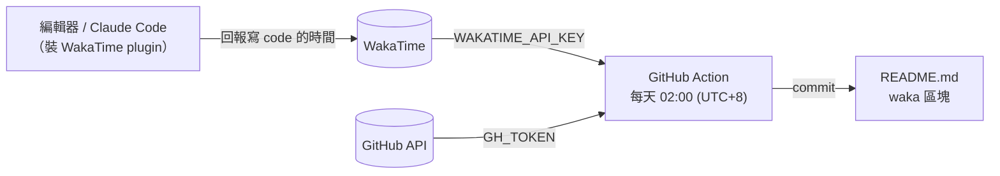

# README 統計怎麼開始

README 裡 `<!--START_SECTION:waka-->` 到 `<!--END_SECTION:waka-->` 之間的內容，由 [`.github/workflows/waka-readme.yml`](../.github/workflows/waka-readme.yml) 每天自動產生，用的是官方的 [anmol098/waka-readme-stats](https://github.com/anmol098/waka-readme-stats)。

## 資料怎麼流



**沒有 WakaTime plugin 在回報，README 就沒有東西可以顯示。** 統計是從 plugin 裝好之後才開始累積的，沒辦法往回補。

## 開始統計要做的事

```text
1. WakaTime
   ├── 註冊帳號
   ├── 每個寫 code 的地方都裝 plugin（https://wakatime.com/plugins）
   │     VS Code、終端機、Claude Code…，只要有一個地方沒裝，那邊的時間就不會算進去
   └── 到 https://wakatime.com/settings/api-key 複製 API key

2. GitHub repo secrets（Settings → Secrets and variables → Actions）
   ├── WAKATIME_API_KEY = 上一步的 API key
   └── GH_TOKEN         = Personal access token（classic），勾 `repo`、`user` scope
                          `user` 是讀 storage 用量、私人 repo 數這些基本資料用的

3. README.md
   └── 放好標記，action 只會改這兩行之間的內容
         <!--START_SECTION:waka-->
         <!--END_SECTION:waka-->

4. 跑一次確認
   └── Actions → Waka Readme → Run workflow
```

## README 上每一塊的來源

| 區塊 | 來源 | 範圍 |
|---|---|---|
| Code Time 徽章 | WakaTime | 從開始用 WakaTime 到現在 |
| AI Code Time 徽章 | WakaTime 的 AI coding 分類 | 同上；沒有 AI 資料就不顯示 |
| My GitHub Data | GitHub API、github-contributions.vercel.app | 現在 |
| This Week I Spent My Time On（時區、語言、編輯器、專案、OS） | WakaTime | 最近 7 天 |
| AI Coding This Week | WakaTime 的 AI coding 分類 | 最近 7 天；沒有資料就顯示「No AI Coding Activity Tracked This Week」 |
| Last Updated | action 執行時間 | — |

## 刻意關掉的統計

這些區塊在 workflow 裡設成 `false`，原因寫在 workflow 的註解裡：

- **Lines of code、Timeline 圖、commit 時段、星期統計**：要把每個 repo、每個 branch 的 commit 全部翻一遍，一次 run 要跑 3 到 5 小時，GitHub API 還常常超時，讓 run 失敗。算法本身也不準：只算新增的行數、lockfile 和 merge commit 都算進去，時間用的是 commit 被提交的時間。
- **Profile Views**：算的是這個 repo 頁面的瀏覽數，不是個人頁的，所以幾乎永遠是 0。
- **I Mostly Code in…**：算的是各語言有幾個 repo，跟 WakaTime 實際的時間統計會互相矛盾。

## 出問題時看哪裡

```text
README 沒更新
├── Actions 的 run 失敗了 → 打開 log，workflow 有開 DEBUG_LOGGING，每一步都會印出來
├── run 成功，但 WakaTime 的區塊是空的 → WakaTime 這週沒收到資料，檢查 plugin 有沒有在回報
└── AI 區塊沒出現 → WakaTime 帳號裡沒有 AI coding 的資料
```
